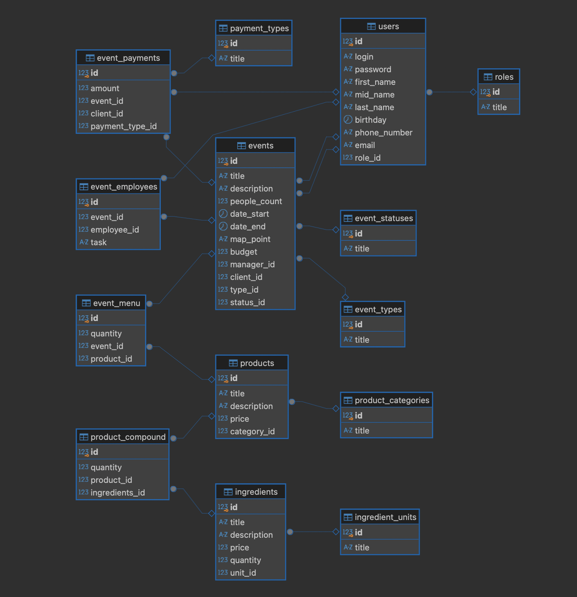

# 🚀 CateringSoftware

**Короткое и емкое описание проекта.** Практические работы в ходе которых будет разработана БД по теме `Кейтеринг и выездной кофе-бар на мероприятия`.

---

## ✨ Практические работы

- [x] [1. Создание базы данных](./reports/first_report.md)
- [x] [2. Доработка базы данных и оптимизация](./reports/second_report.md)
- [x] [3. Администрирование](./reports/third_report.md)
- [x] [4. Работа с транзакциями](./reports/fourth_report.md)
- [x] [5. Работа с группами ролей и ролями](./reports/fifth_report.md) 
- [x] [6. Работа с индексами](./reports/sixth_report.md)
- [x] [7. Резервное копирование базы данных](./reports/seventh_report.md)
- [x] [8. Сбор статистики базы данных](./reports/eighth_report.md)

---

## 📸 Скриншоты

| ER-Диаграмма | Личный кабинет |
| :---: | :---: |
|  |  |

---

## 🛠 Стек технологий

- **Frontend:** -
- **Backend:** PostgreSQL
- **DevOps:** Docker, GitHub Actions

---

## ⚙️ Переменные окружения (.env)

Для корректной работы проекта создайте файл `.env` в корневой директории и добавьте следующие переменные:

| Переменная | Описание | Значение по умолчанию |
| :--- | :--- | :--- |
| `POSTGRES_USER` | Имя пользователя | `На свое усмотрение` |
| `POSTGRES_PASSWORD` | Пароль пользователя | `На свое усмотрение` |
| `POSTGRES_DB` | Название БД | `На свое усмотрение` |
| `POSTGRES_PORT` | Порт для запуска сервера | `5434` |
| `POSTGRES_HOST` | Хост для запуска сервера | `localhost` |

---

## 🚀 Быстрый старт (Getting Started)

1. Клонируйте репозиторий:
   ```bash
   git clone https://github.com
   ```
2. Перейдите в папку проекта:
   ```bash
   cd имя-репозитория
   ```

### Запуск проекта

Для запуска проекта в режиме разработки выполните:
1. Перейдите в директорию src:
   ```bash
   cd src
   ```
2. Создайте `.env` файл по инструкции описанной в пункте `⚙️ Переменные окружения (.env)`.
3. Поднимите контейнер по заранее созданному образу:
   ```bash
   docker compose up -d
   ```

---

## 👨‍💻 Авторы

- **Щекин Дмитрий** — *Разработчик №1* — [@jjllllfff](https://t.me/jjllllfff)
- **Азрапкин Алексей** — *Разработчик №2* — [@его_github](https://github.com)
