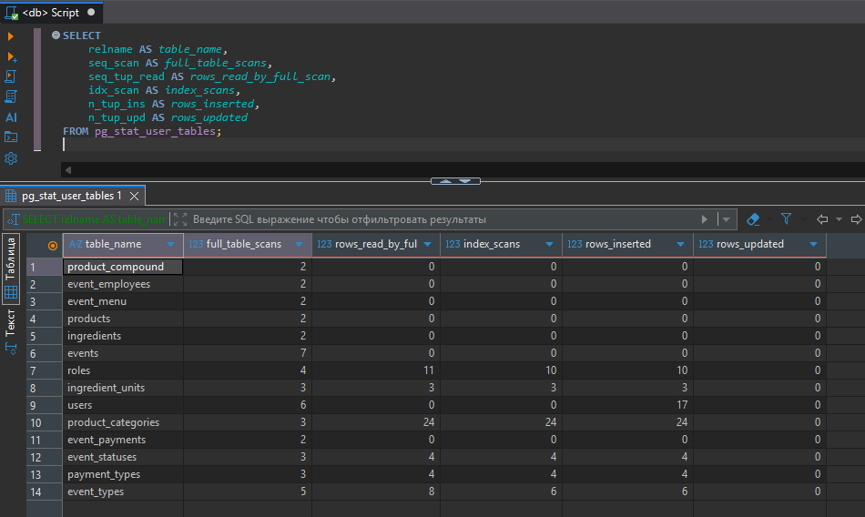
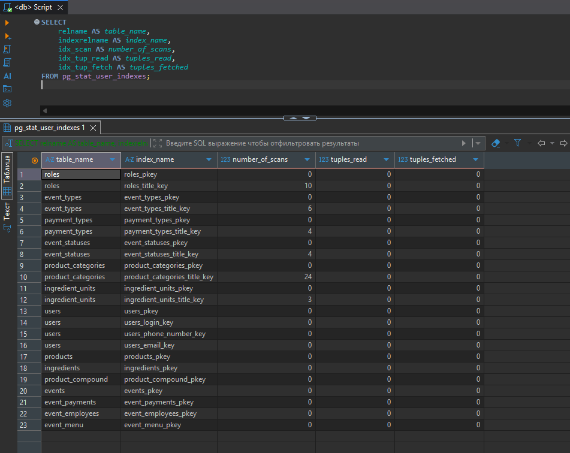
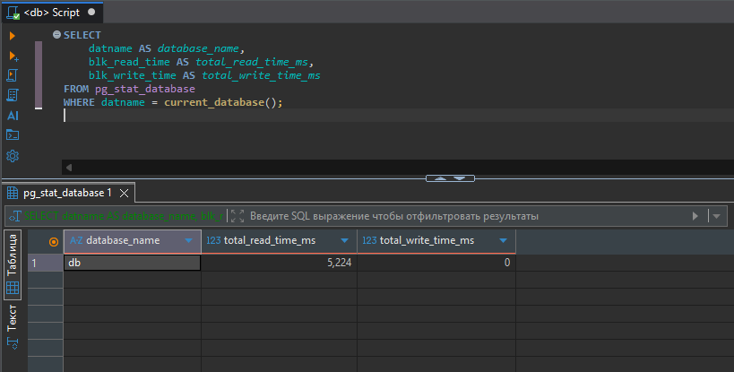
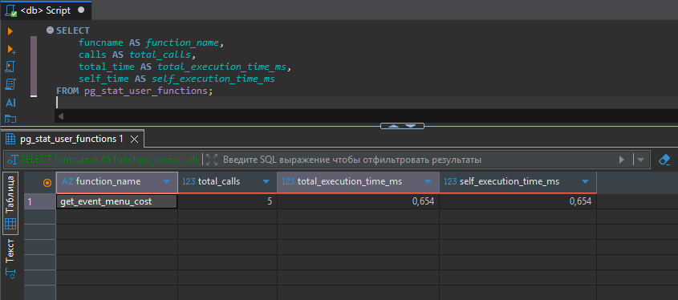

# 🏛️ Практика №8: Сбор статистики базы данных

**Дисциплина:** [Клиент-серверные системы управления базами данных](../README.md)  
**Бэкап-файл:** [backup_docker.sh](../backup_docker.sh)  
**Предыдущая работа:** [Практика №7: Резервное копирование базы данных](./seventh_report.md)

> 💡 *Примечание: Все имена, персонажи и данные в настоящей работе являются вымышленными. Любое совпадение с реальными людьми случайно.*

---

## 🎯 Техническое задание

Настроили СУБД на сбор статистической информации на сбор статистики по обращениям к таблицам и индексам, по отслеживанию пользовательских функций, по времени чтения и записи блоков.

---

## 📥 DML: Запросы

### 1. Включение сбора статистики в конфигурации

```sql 
ALTER SYSTEM SET track_io_timing = on;
ALTER SYSTEM SET track_functions = 'all';
SELECT pg_reload_conf();

```


### 2. Мониторинг собранной статистики

```sql
SELECT 
    relname AS table_name,
    seq_scan AS full_table_scans,
    seq_tup_read AS rows_read_by_full_scan,
    idx_scan AS index_scans,
    n_tup_ins AS rows_inserted,
    n_tup_upd AS rows_updated
FROM pg_stat_user_tables;
```



```sql
SELECT 
    relname AS table_name,
    seq_scan AS full_table_scans,
    seq_tup_read AS rows_read_by_full_scan,
    idx_scan AS index_scans,
    n_tup_ins AS rows_inserted,
    n_tup_upd AS rows_updated
FROM pg_stat_user_tables;
```



```sql
SELECT 
    relname AS table_name,
    seq_scan AS full_table_scans,
    seq_tup_read AS rows_read_by_full_scan,
    idx_scan AS index_scans,
    n_tup_ins AS rows_inserted,
    n_tup_upd AS rows_updated
FROM pg_stat_user_tables;
```



```sql
SELECT 
    relname AS table_name,
    seq_scan AS full_table_scans,
    seq_tup_read AS rows_read_by_full_scan,
    idx_scan AS index_scans,
    n_tup_ins AS rows_inserted,
    n_tup_upd AS rows_updated
FROM pg_stat_user_tables;
```



---

## 📝 Заключение

В ходе выполнения практической работы были успешно изучены и применены инструменты профилирования, аудита и сбора низкоуровневой статистической информации в СУБД PostgreSQL, развернутой в контейнеризованной среде Docker.

Были достигнуты следующие результаты:
* **Сконфигурирована подсистема мониторинга СУБД** посредством изменения глобальных параметров `track_io_timing` и `track_functions`. Это позволило осуществлять детальный сбор метрик ввода-вывода и регистрировать внутренние показатели выполнения PL/pgSQL-кода.
* **Налажен мониторинг обращений к объектам БД**, обеспечивающий прозрачный аудит эффективности использования таблиц и индексов. На основе системных представлений `pg_stat_user_tables` и `pg_stat_user_indexes` реализован механизм выявления неэффективных последовательных сканирований (`Seq Scan`) и оценки применимости созданных ранее B-Tree индексов.
* **Реализован анализ дисковой подсистемы и кэша** через представление `pg_statio_user_tables`. Зафиксировано соотношение чтения данных из оперативной памяти (`blocks_hit`) и физического диска (`blocks_read`), а также точное время задержек на чтение/запись блоков в миллисекундах.
* **Организован хронометраж бизнес-логики** благодаря логированию работы пользовательских функций в `pg_stat_user_functions`, что позволяет находить «узкие места» в коде процедур при параллельном выполнении транзакций.

В результате проделанной настройки база данных получила развитый инструментарий для проведения проактивного администрирования, оптимизации медленных запросов и контроля производительности клиент-серверной системы.
