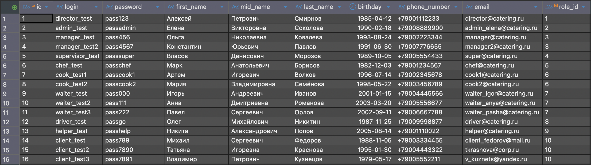
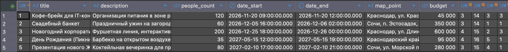
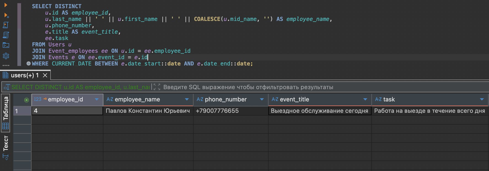
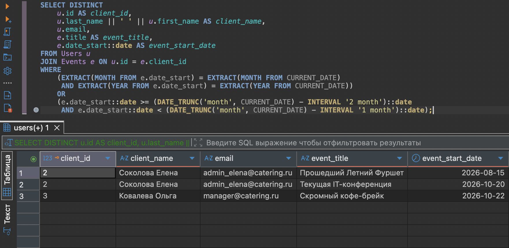
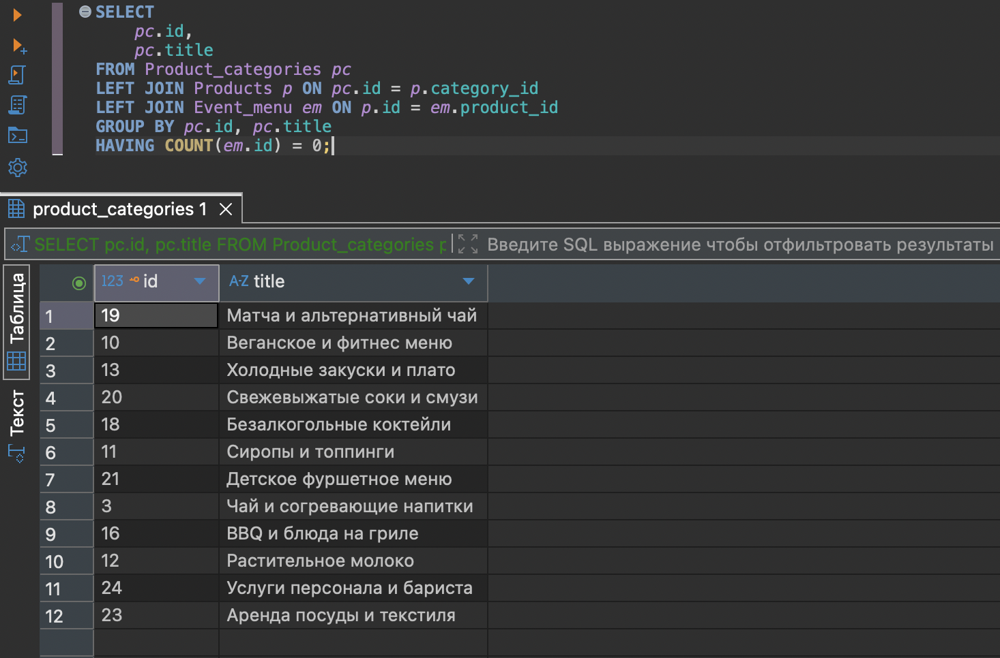
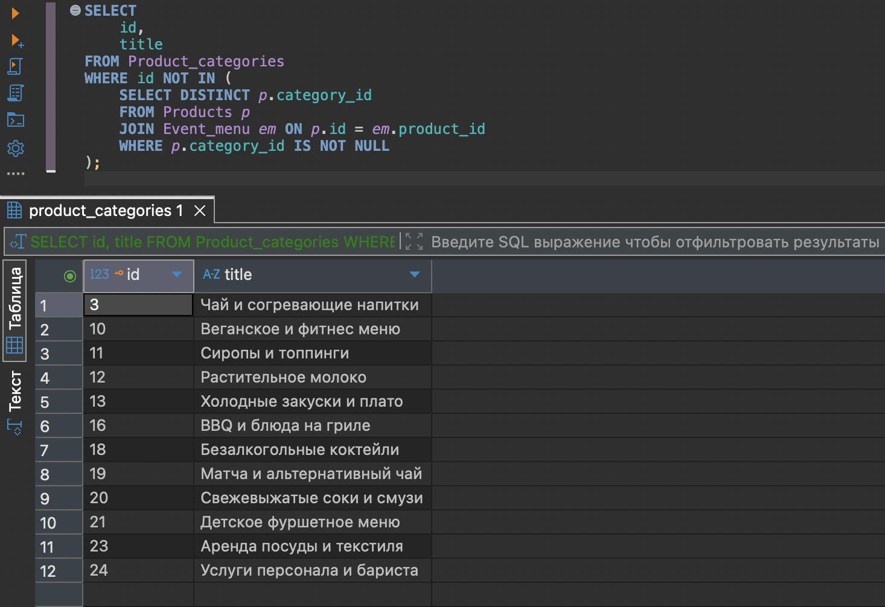
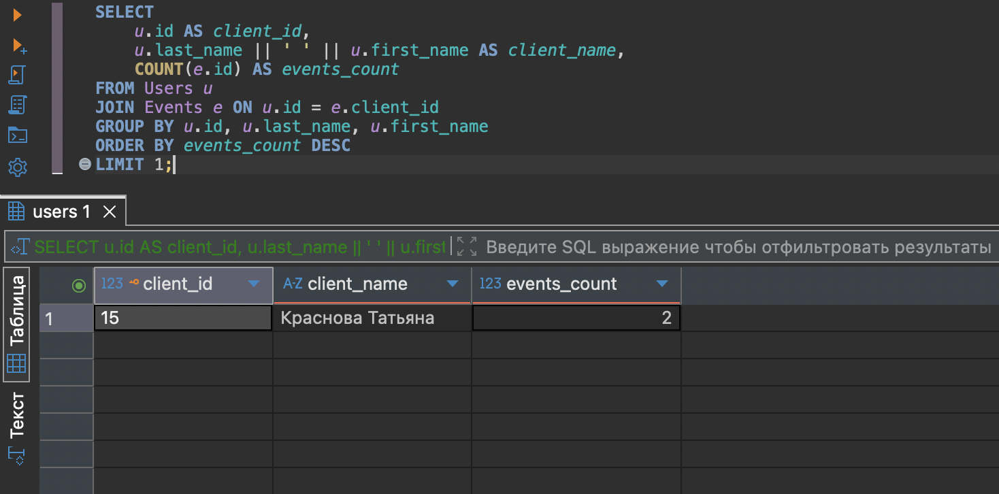
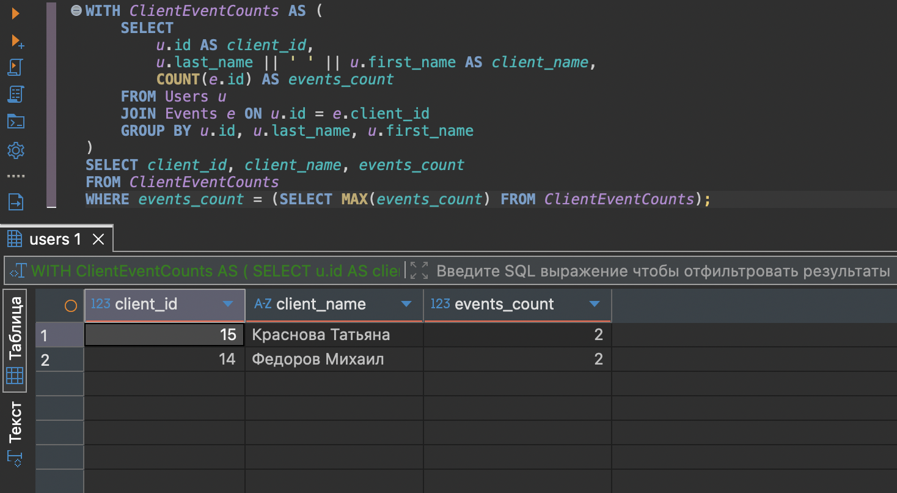
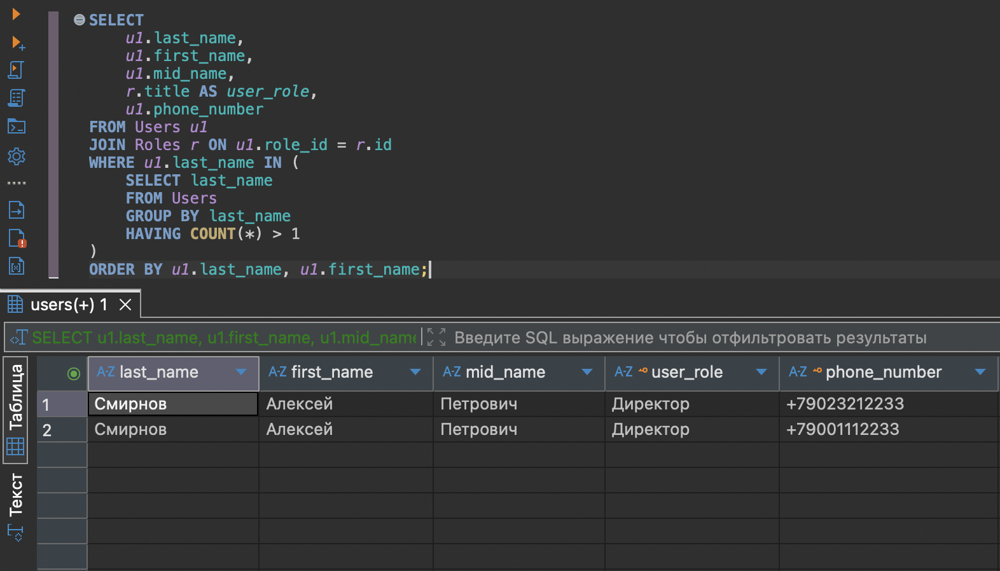

# 🏛️ Практика №1: Создание и проектирование базы данных кейтеринга

**Дисциплина:** [Клиент-серверные системы управления базами данных](../README.md)  
**Исходный код:** [first_practice.sql](../src/database/first_practice.sql)  
**Следующая работа:** [Практика №2 - Доработка базы данных и оптимизация](./second_report.md)

> 💡 *Примечание: Все имена, персонажи и данные в настоящей работе являются вымышленными. Любое совпадение с реальными людьми случайно.*

---

## 🎯 Техническое задание

1. **Проектирование структуры:** Создать базу данных для автоматизации кейтеринговой компании (~14 взаимосвязанных таблиц).
2. **Разработка аналитических запросов:**
   - **a.** Реализовать выборку данных двумя способами с оценкой производительности (на примере поиска невостребованных категорий товаров).
   - **b.** Вывести список сотрудников, задействованных на мероприятиях в текущую дату (на выезде).
   - **c.** Вывести упорядоченные списки клиентов, чьи мероприятия начались в текущем и позапрошлом месяцах.
   - **d.** Найти пользователей с одинаковыми фамилиями, зарегистрированных в системе.
   - **e.** Сформировать список категорий товаров, продукты из которых еще ни разу не добавлялись в меню мероприятий.
   - **f.** Определить клиента, который оформил наибольшее количество заказов на мероприятия.

---

## 📐 ER-Диаграмма сущностей

Связи типа **многие-ко-многим (M:N)** реализованы через промежуточные таблицы:
- `Product_compound` связывает `Products` и `Ingredients`.
- `Event_employees` связывает `Events` и `Users` (сотрудники).
- `Event_menu` связывает `Events` и `Products`.

---

## 💻 DDL: Инициализация структуры БД

```sql
CREATE TABLE IF NOT EXISTS Roles(
    id SERIAL PRIMARY KEY,
    title VARCHAR(100) UNIQUE NOT NULL
);

CREATE TABLE IF NOT EXISTS Event_types(
    id SERIAL PRIMARY KEY,
    title VARCHAR(100) UNIQUE NOT NULL
);

CREATE TABLE IF NOT EXISTS Payment_types(
    id SERIAL PRIMARY KEY,
    title VARCHAR(100) UNIQUE NOT NULL
);

CREATE TABLE IF NOT EXISTS Event_statuses(
    id SERIAL PRIMARY KEY,
    title VARCHAR(100) UNIQUE NOT NULL
);

CREATE TABLE IF NOT EXISTS Product_categories(
    id SERIAL PRIMARY KEY,
    title VARCHAR(100) UNIQUE NOT NULL
);

CREATE TABLE IF NOT EXISTS Ingredient_Units(
    id SERIAL PRIMARY KEY,
    title VARCHAR(100) UNIQUE NOT NULL
);

CREATE TABLE IF NOT EXISTS Users(
    id SERIAL PRIMARY KEY,
    login VARCHAR(255) UNIQUE NOT NULL,
    password VARCHAR(255) NOT NULL,
    first_name VARCHAR(50) NOT NULL,
    mid_name VARCHAR(50),
    last_name VARCHAR(50) NOT NULL,
    birthday DATE,
    phone_number VARCHAR(20) UNIQUE NOT NULL,
    email VARCHAR(255) UNIQUE NOT NULL,
    role_id INT REFERENCES Roles(id)
);

CREATE TABLE IF NOT EXISTS Products(
    id SERIAL PRIMARY KEY,
    title VARCHAR(100) NOT NULL,
    description TEXT,
    price NUMERIC(10,2) DEFAULT 0,
    category_id INT REFERENCES Product_categories(id)
);

CREATE TABLE IF NOT EXISTS Ingredients(
    id SERIAL PRIMARY KEY,
    title VARCHAR(100) NOT NULL,
    description TEXT,
    price NUMERIC(10,2) DEFAULT 0,
    quantity INT DEFAULT 0,
    unit_id INT REFERENCES Ingredient_Units(id)
);

CREATE TABLE IF NOT EXISTS Product_compound(
    id SERIAL PRIMARY KEY,
    quantity INT DEFAULT 0,
    product_id INT REFERENCES Products(id),
    ingredients_id INT REFERENCES Ingredients(id)
);

CREATE TABLE IF NOT EXISTS Events(
    id SERIAL PRIMARY KEY,
    title VARCHAR(100) NOT NULL,
    description TEXT,
    people_count INT NOT NULL,
    date_start TIMESTAMP NOT NULL,
    date_end TIMESTAMP NOT NULL,
    map_point VARCHAR(255) NOT NULL,
    budget NUMERIC(10,2) DEFAULT 0,
    manager_id INT REFERENCES Users(id),
    client_id INT REFERENCES Users(id),
    type_id INT REFERENCES Event_types(id),
    status_id INT REFERENCES Event_statuses(id)
);

CREATE TABLE IF NOT EXISTS Event_payments(
    id SERIAL PRIMARY KEY,
    amount NUMERIC(10,2) DEFAULT 0,
    event_id INT REFERENCES Events(id),
    client_id INT REFERENCES Users(id),
    payment_type_id INT REFERENCES Payment_types(id)
);

CREATE TABLE IF NOT EXISTS Event_employees(
    id SERIAL PRIMARY KEY,
    event_id INT REFERENCES Events(id),
    employee_id INT REFERENCES Users(id),
    task VARCHAR(100)
);

CREATE TABLE IF NOT EXISTS Event_menu(
    id SERIAL PRIMARY KEY,
    quantity INT DEFAULT 0,
    event_id INT REFERENCES Events(id),
    product_id INT REFERENCES Products(id)
);
```

---

## 📥 DML: Наполнение данными (Seed)

```sql
-- заполнение справочников
INSERT INTO Roles(title) VALUES 
('Директор'), ('Администратор'), ('Менеджер'), ('Супервайзер'), ('Шеф-повар'), 
('Повар-универсал'), ('Официант'), ('Доставщик'), ('Хелпер'), ('Заказчик')
ON CONFLICT (title) DO NOTHING;

INSERT INTO Event_types(title) VALUES 
('Банкет'), ('Фуршет'), ('Кофе-брейк'), ('Коктейльная-вечеринка'), ('Пикник'), ('Гала-ужин')
ON CONFLICT (title) DO NOTHING;

INSERT INTO Payment_types(title) VALUES 
('Наличные'), ('Банковская карта'), ('Безналичный расчет'), ('СБП')
ON CONFLICT (title) DO NOTHING;

INSERT INTO Event_statuses(title) VALUES 
('В обработке'), ('Отменен'), ('В работе'), ('Завершен')
ON CONFLICT (title) DO NOTHING;

INSERT INTO Product_categories(title) VALUES 
('Классический кофе'), ('Авторские рафы и латте'), ('Чай и согревающие напитки'), 
('Лимонады и айс-кофе'), ('Канапе и брускетты'), ('Мини-бургеры и тарталетки'), 
('Горячие закуски'), ('Десерты и выпечка'), ('Сладкие боксы и макаронс'), 
('Веганское и фитнес меню'), ('Сиропы и топпинги'), ('Растительное молоко'), 
('Холодные закуски и плато'), ('Салаты в верринах'), ('Стрит-фуд и мини-доги'), 
('BBQ и блюда на гриле'), ('Фруктовые тарелки и шпажки'), ('Безалкогольные коктейли'), 
('Матча и альтернативный чай'), ('Свежевыжатые соки и смузи'), ('Детское фуршетное меню'), 
('Праздничные торты'), ('Аренда посуды и текстиля'), ('Услуги персонала и бариста')
ON CONFLICT (title) DO NOTHING;

INSERT INTO Ingredient_Units(title) VALUES 
('Кг'), ('Литр'), ('Шт')
ON CONFLICT (title) DO NOTHING;

--заполнение основных таблиц
INSERT INTO Users (login, password, first_name, mid_name, last_name, birthday, phone_number, email, role_id) VALUES
('director_test', 'pass123', 'Алексей', 'Петрович', 'Смирнов', '1985-04-12', '+79001112233', 'director@catering.ru', 1),
('admin_test', 'passadmin', 'Елена', 'Викторовна', 'Соколова', '1990-02-18', '+79008889900', 'admin_elena@catering.ru', 2),
('manager_test', 'pass456', 'Ольга', 'Николаевна', 'Ковалева', '1993-08-24', '+79002223344', 'manager@catering.ru', 3),
('manager_test2', 'pass4567', 'Константин', 'Юрьевич', 'Павлов', '1991-06-30', '+79007776655', 'manager2@catering.ru', 3),
('supervisor_test', 'passsuper', 'Власов', 'Денисович', 'Морозов', '1989-10-05', '+79005554433', 'super@catering.ru', 4),
('chef_test', 'passchef', 'Марк', 'Анатольевич', 'Борисов', '1982-12-03', '+79001234567', 'chef@catering.ru', 5),
('cook_test1', 'passcook1', 'Артем', 'Игоревич', 'Волков', '1996-07-14', '+79002345678', 'cook1@catering.ru', 6),
('cook_test2', 'passcook2', 'Мария', 'Владимировна', 'Семёнова', '1998-05-22', '+79003456789', 'cook2@catering.ru', 6),
('waiter_test', 'pass000', 'Игорь', 'Андреевич', 'Иванов', '2001-01-15', '+79004445566', 'waiter_igor@catering.ru', 7),
('waiter_test2', 'pass111', 'Анна', 'Дмитриевна', 'Романова', '2003-03-20', '+79005556677', 'waiter_anya@catering.ru', 7),
('waiter_test3', 'pass222', 'Павел', 'Сергеевич', 'Орлов', '2002-09-11', '+79006667788', 'waiter_pasha@catering.ru', 7),
('driver_test', 'passgo', 'Олег', 'Михайлович', 'Никитин', '1987-11-25', '+79009998877', 'driver@catering.ru', 8),
('helper_test', 'passhelp', 'Никита', 'Александрович', 'Попов', '2005-08-14', '+79001110022', 'helper@catering.ru', 9),
('client_test', 'pass789', 'Михаил', 'Сергеевич', 'Федоров', '1988-11-05', '+79003334455', 'client_fedorov@mail.ru', 10),
('client_test2', 'pass7890', 'Татьяна', 'Игоревна', 'Краснова', '1995-01-30', '+79004443322', 'tkrasnova@corp.ru', 10),
('client_test3', 'pass7891', 'Владимир', 'Петрович', 'Кузнецов', '1979-05-17', '+79005552211', 'v_kuznets@yandex.ru', 10);

INSERT INTO Products (title, description, price, category_id) VALUES
('Капучино 300мл', 'Классический кофейный напиток с молочной пеной', 190.00, 1),
('Американо 200мл', 'Классический черный кофе', 140.00, 1),
('Флэт Уайт', 'Насыщенный кофейный напиток с двойным эспрессо', 220.00, 1),
('Раф Лаванда', 'Авторский нежный напиток со вкусом лаванды', 260.00, 2),
('Латте Соленая карамель', 'Кофейный напиток с добавлением карамельного сиропа и морской соли', 250.00, 2),
('Чай Таежный сбор', 'Травяной согревающий чай с ягодами', 180.00, 3),
('Классический лимонад', 'Освежающий напиток с лимоном и мятой', 200.00, 4),
('Брускетта с лососем', 'Хрустящий багет, творожный сыр, слабосоленый лосось, зелень', 180.00, 5),
('Брускетта с вялеными томатами', 'Багет, крем-сыр, вяленые томаты, руккола', 150.00, 5),
('Канапе с креветкой', 'Тигровая креветка, авокадо, огурец', 110.00, 5),
('Мини-бургер с говядиной', 'Сочная котлета, сыр чеддер, соус барбекю', 220.00, 6),
('Тарталетка с куриным паштетом', 'Песочная корзинка, нежный паштет, ягодный конфитюр', 95.00, 6),
('Мини-шашлычки из курицы', 'Подаются на шпажках с соусом', 240.00, 7),
('Круассан классический', 'Свежая выпечка на сливочном масле', 130.00, 8),
('Маффин шоколадный', 'Пышный кекс с кусочками натурального шоколада', 110.00, 8),
('Набор Макаронс 6шт', 'Ассорти из французских десертов', 450.00, 9),
('Салат Цезарь в веррине', 'Классический салат в порционном стаканчике', 160.00, 14),
('Мини хот-дог', 'Мини булочка, сосиска гриль, горчичный соус', 140.00, 15),
('Фруктовая шпажка', 'Ананас, виноград, киви, клубника', 90.00, 17),
('Торт Свадебный трехъярусный', 'Праздничный торт с начинкой из лесных ягод', 12000.00, 22);

INSERT INTO Ingredients (title, description, price, quantity, unit_id) VALUES
('Кофе в зернах Blend', 'Свежая обжарка, арабика/робуста', 1500.00, 20, 1),
('Молоко ультрапаст. 3,2%', 'Для кофейных напитков', 85.00, 100, 2),
('Сливки 10%', 'Для раф-кофе', 190.00, 30, 2),
('Сироп Лаванда', 'Профессиональный сироп', 450.00, 5, 3),
('Лосось слабосоленый', 'Филе на коже', 2400.00, 15, 1),
('Вяленые томаты', 'В подсолнечном масле со специями', 850.00, 8, 1),
('Багет пшеничный', 'Выпечка для брускетт', 45.00, 50, 3),
('Тигровые креветки', 'Свежемороженые, очищенные', 1200.00, 10, 1),
('Говяжий фарш', 'Охлажденный полуфабрикат', 650.00, 25, 1),
('Булочки для мини-бургеров', 'Пшеничные с кунжутом', 15.00, 400, 3),
('Куриное филе', 'Охлажденное', 380.00, 30, 1),
('Мука пшеничная', 'Высший сорт', 60.00, 50, 1),
('Сливочное масло 82.5%', 'Натуральное', 900.00, 15, 1),
('Салат Романо', 'Свежая зелень', 400.00, 5, 1),
('Ассорти фруктов', 'Ананас, виноград, киви, клубника', 350.00, 40, 1);

INSERT INTO Product_compound (quantity, product_id, ingredients_id) VALUES
(15, 1, 1),
(220, 1, 2),
(15, 2, 1),
(30, 3, 1),
(180, 3, 2),
(15, 4, 1),
(200, 4, 3),
(15, 4, 4),
(40, 8, 5),
(25, 8, 7),
(30, 9, 6),
(25, 9, 7),
(15, 10, 8),
(60, 11, 9),
(1, 11, 10),
(80, 13, 11),
(40, 14, 12),
(35, 14, 13),
(30, 17, 14),
(100, 19, 15);

INSERT INTO Events (title, description, people_count, date_start, date_end, map_point, budget, manager_id, client_id, type_id, status_id) VALUES
('Кофе-брейк для IT-конференции', 'Организация питания в зоне регистрации', 120, '2026-11-20 09:00:00', '2026-11-20 12:00:00', 'Краснодар, ул. Красная 10, Точка Кипения', 45000.00, 3, 14, 3, 3),
('Свадебный банкет', 'Праздничный ужин на загородной вилле', 60, '2026-12-05 16:00:00', '2026-12-06 02:00:00', 'Сочи, п. Эстосадок, вилла "Горный воздух"', 350000.00, 3, 14, 1, 1),
('Новогодний корпоратив Альфа-Банк', 'Фуршетная линия, интерактивные станции баристы и барменов', 200, '2026-12-25 18:00:00', '2026-12-26 00:00:00', 'Краснодар, ул. Длинная 120, Лофт Особняк', 600000.00, 4, 15, 2, 3),
('День Рождения (Пикник)', 'Барбекю на открытом воздухе, детская зона', 35, '2027-05-15 12:00:00', '2027-05-15 19:00:00', 'Краснодарский край, усадьба "Фазенда"', 95000.00, 4, 16, 5, 1),
('Презентация нового ЖК', 'Коктейльная вечеринка для премиум-клиентов', 80, '2027-02-10 17:00:00', '2027-02-10 21:00:00', 'Сочи, ул. Морской переулок 2, Отель Хаятт', 280000.00, 3, 15, 4, 1);

INSERT INTO Event_payments (amount, event_id, client_id, payment_type_id) VALUES
(45000.00, 1, 14, 3),
(100000.00, 2, 14, 2),
(50000.00, 2, 14, 1),
(300000.00, 3, 15, 3),
(300000.00, 3, 15, 3),
(95000.00, 4, 16, 4),
(140000.00, 5, 15, 2);

INSERT INTO Event_employees (event_id, employee_id, task) VALUES
(1, 9, 'Работа на мобильной кофейной станции, выдача напитков'),
(1, 13, 'Помощь на бэкстейдже, вынос посуды'),
(2, 6, 'Контроль кухни и тайминга подачи горячих блюд'),
(2, 7, 'Приготовление закусок и брускетт'),
(2, 9, 'Обслуживание столов №1 и №2 в главном зале'),
(2, 10, 'Обслуживание столов №3 и №4 в главном зале'),
(3, 5, 'Общий надзор за работой персонала на площадке'),
(3, 9, 'Обслуживание фуршетной линии зона А'),
(3, 10, 'Обслуживание фуршетной линии зона Б'),
(3, 11, 'Обслуживание VIP-зоны'),
(3, 12, 'Доставка оборудования и текстиля на площадку'),
(4, 8, 'Приготовление блюд на гриле и открытом огне'),
(4, 11, 'Обслуживание гостей в шашлычной зоне'),
(5, 9, 'Работа на коктейльном баре, выдача лимонадов'),
(5, 10, 'Встреча гостей, подача приветственных канапе');

INSERT INTO Event_menu (quantity, event_id, product_id) VALUES
(150, 1, 1),
(50, 1, 2),
(100, 1, 14),
(100, 1, 15),
(60, 2, 8),
(60, 2, 9),
(60, 2, 13),
(1, 2, 20),
(200, 3, 4),
(150, 3, 5),
(300, 3, 10),
(250, 3, 11),
(200, 3, 12),
(150, 3, 16),
(200, 3, 17),
(50, 4, 13),
(70, 4, 18),
(50, 4, 19),
(100, 4, 7),
(120, 5, 10),
(100, 5, 8),
(100, 5, 12),
(150, 5, 7),
(80, 5, 5);
```

### 📊 Текущее состояние таблиц после инициализации




---

## 🔍 Реализация аналитических запросов

### 1. Сотрудники, находящиеся на выезде (задействованные на мероприятиях сегодня)

```sql
SELECT DISTINCT 
    u.id AS employee_id,
    u.last_name || ' ' || u.first_name || ' ' || COALESCE(u.mid_name, '') AS employee_name,
    u.phone_number,
    e.title AS event_title,
    ee.task
FROM Users u
JOIN Event_employees ee ON u.id = ee.employee_id
JOIN Events e ON ee.event_id = e.id
WHERE CURRENT_DATE BETWEEN e.date_start::date AND e.date_end::date;

```



### 2. Списки клиентов, чьи мероприятия начались за определенные периоды (текущий и позапрошлый месяцы)

```sql
SELECT DISTINCT 
    u.id AS client_id,
    u.last_name || ' ' || u.first_name AS client_name,
    u.email,
    e.title AS event_title,
    e.date_start::date AS event_start_date
FROM Users u
JOIN Events e ON u.id = e.client_id
WHERE 
    (EXTRACT(MONTH FROM e.date_start) = EXTRACT(MONTH FROM CURRENT_DATE) 
     AND EXTRACT(YEAR FROM e.date_start) = EXTRACT(YEAR FROM CURRENT_DATE))
    OR 
    (e.date_start::date >= (DATE_TRUNC('month', CURRENT_DATE) - INTERVAL '2 month')::date 
     AND e.date_start::date < (DATE_TRUNC('month', CURRENT_DATE) - INTERVAL '1 month')::date);
```



### 3. Анализ неактивных категорий меню (Сравнение оптимизации)

| Метод оптимизации | SQL-запрос | Производительность |
| :--- | :--- | :--- |
| **Вариант А (LEFT JOIN / GROUP BY)** | `SELECT pc.id, pc.title FROM Product_categories pc<br>LEFT JOIN Products p ON pc.id = p.category_id<br>LEFT JOIN Event_menu em ON p.id = em.product_id<br>GROUP BY pc.id, pc.title<br>HAVING COUNT(em.id) = 0;` | ⏱️ **107 мс** |
| **Вариант Б (Вложенный подзапрос NOT IN)** | `SELECT id, title FROM Product_categories<br>WHERE id NOT IN (<br> SELECT DISTINCT p.category_id FROM Products p<br> JOIN Event_menu em ON p.id = em.product_id<br> WHERE p.category_id IS NOT NULL<br>);` | ⏱️ **98 мс** *(Быстрее)* |

#### Скриншоты выполнения планов запросов:
* **Вариант А:** 
* **Вариант Б:** 

> **Вывод:** Оба запроса выдают идентичный результат на малом объеме данных. Вариант Б с `NOT IN` отрабатывает на **~9% быстрее**, так как база данных избегает построения хэш-таблицы для группировки большого количества категорий.

### 4. Поиск наиболее активных заказчиков (Максимальное число мероприятий)

**Быстрый вариант (Выводит ровно 1 запись с лимитом):**

```sql
SELECT 
    u.id AS client_id,
    u.last_name || ' ' || u.first_name AS client_name,
    COUNT(e.id) AS events_count
FROM Users u
JOIN Events e ON u.id = e.client_id
GROUP BY u.id, u.last_name, u.first_name
ORDER BY events_count DESC
LIMIT 1;

```



---

**Гибкий вариант (Выводит всех лидеров при одинаковом максимуме):**

```sql
WITH ClientEventCounts AS (
    SELECT 
        u.id AS client_id,
        u.last_name || ' ' || u.first_name AS client_name,
        COUNT(e.id) AS events_count
    FROM Users u
    JOIN Events e ON u.id = e.client_id
    GROUP BY u.id, u.last_name, u.first_name
)
SELECT client_id, client_name, events_count
FROM ClientEventCounts
WHERE events_count = (SELECT MAX(events_count) FROM ClientEventCounts);

```



### 5. Поиск однофамильцев в системе пользователей

```sql
SELECT 
    u1.last_name,
    u1.first_name,
    u1.mid_name,
    r.title AS user_role,
    u1.phone_number
FROM Users u1
JOIN Roles r ON u1.role_id = r.id
WHERE u1.last_name IN (
    SELECT last_name 
    FROM Users 
    GROUP BY last_name 
    HAVING COUNT(*) > 1
)
ORDER BY u1.last_name, u1.first_name;
```



---

## 📝 Заключение

В ходе выполнения лабораторной работы были освоены фундаментальные возможности СУБД **PostgreSQL** применительно к бизнес-модели кейтеринговой службы:
* Проектирование реляционной структуры данных со связями «один-ко-многим» и «многие-ко-многим».
* Управление ограничениями целостности данных с помощью первичных (`PRIMARY KEY`) и внешних (`FOREIGN KEY`) ключей в каскадных моделиях.
* Написание аналитических SQL-запросов с использованием многотабличных соединений (`JOIN`), вложенных подзапросов и агрегатных проверок (`HAVING COUNT`).
* Проведение сравнительного анализа производительности алгоритмов фильтрации данных для оптимизации скорости работы СУБД.
