# 🏛️ Практика №2: Доработка базы данных и оптимизация

**Дисциплина:** [Клиент-серверные системы управления базами данных](../README.md)  
**Запросы:** [first_practice.sql](../src/database/second_practice.sql)  
**Предыдущая работа:** [Практика №1: Создание и проектирование базы данных кейтеринга](./first_report.md)
**Следующая работа:** [Практика №3: Администрирование](./third_report.md)

> 💡 *Примечание: Все имена, персонажи и данные в настоящей работе являются вымышленными. Любое совпадение с реальными людьми случайно.*

---

## 🎯 Техническое задание

1. **Добавить в выбранную по вариантам базу данных дополнительно пять связанных отношений;**
2. **Сделать 20 уникальных запросов к базе данных** (уникальные означает неповторяющиеся сочетания ключевых слов);
3. **Внести не менее 10 замечаний по работе базы данных** (нарушения НФ, оптимизация типизации, оптимизация производительности, ограничения, лишние связи и т. д.);

---

## 💻 DDL: Доработка структуры БД

```sql
CREATE TABLE IF NOT EXISTS Suppliers (
    id SERIAL PRIMARY KEY,
    company_name VARCHAR(150) NOT NULL,
    contact_person VARCHAR(100),
    phone VARCHAR(20) UNIQUE NOT NULL,
    email VARCHAR(255) UNIQUE
);

CREATE TABLE IF NOT EXISTS Ingredient_Deliveries (
    id SERIAL PRIMARY KEY,
    supplier_id INT REFERENCES Suppliers(id),
    ingredient_id INT REFERENCES Ingredients(id),
    delivery_date TIMESTAMP DEFAULT CURRENT_TIMESTAMP,
    quantity INT NOT NULL CHECK (quantity > 0),
    purchase_price NUMERIC(10,2) NOT NULL CHECK (purchase_price >= 0)
);

CREATE TABLE IF NOT EXISTS Equipment (
    id SERIAL PRIMARY KEY,
    title VARCHAR(100) NOT NULL,
    total_quantity INT NOT NULL DEFAULT 0,
    rental_price_per_day NUMERIC(10,2) DEFAULT 0
);

CREATE TABLE IF NOT EXISTS Event_Equipment (
    id SERIAL PRIMARY KEY,
    event_id INT REFERENCES Events(id),
    equipment_id INT REFERENCES Equipment(id),
    quantity INT NOT NULL DEFAULT 1 CHECK (quantity > 0)
);

CREATE TABLE IF NOT EXISTS Event_Reviews (
    id SERIAL PRIMARY KEY,
    event_id INT UNIQUE REFERENCES Events(id),
    client_id INT REFERENCES Users(id),
    rating INT NOT NULL CHECK (rating BETWEEN 1 AND 5),
    feedback_text TEXT,
    created_at TIMESTAMP DEFAULT CURRENT_TIMESTAMP
);
```

---

## 📥 DML: Отрисовка данных

### 1. Выборка пользователей по конкретной роли

```sql
SELECT id, login, email FROM Users WHERE role_id = 1;
```

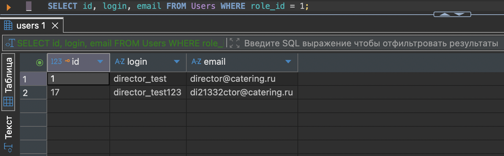

### 2. Алфавитный список уникальных фамилий

```sql
SELECT DISTINCT last_name FROM Users WHERE last_name LIKE 'И%' ORDER BY last_name ASC;
```

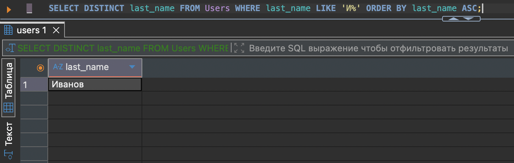

### 3. Фильтрация товаров по ценовому диапазону и категориям

```sql
SELECT * FROM Products WHERE (price BETWEEN 500.00 AND 1500.00) AND (category_id = 2 OR category_id = 3);
```

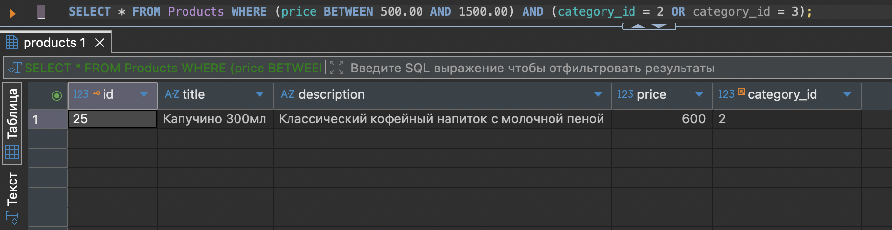

### 4. Выгрузка мероприятий по статусам с исключением менеджера

```sql
SELECT id, title, budget FROM Events WHERE status_id IN (3, 4) AND manager_id NOT IN (10);
```

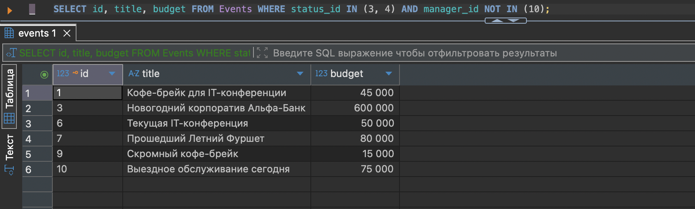

### 5. Поиск записей с незаполненными данными

```sql
SELECT id, title FROM Ingredients WHERE description IS NULL LIMIT 5;
```

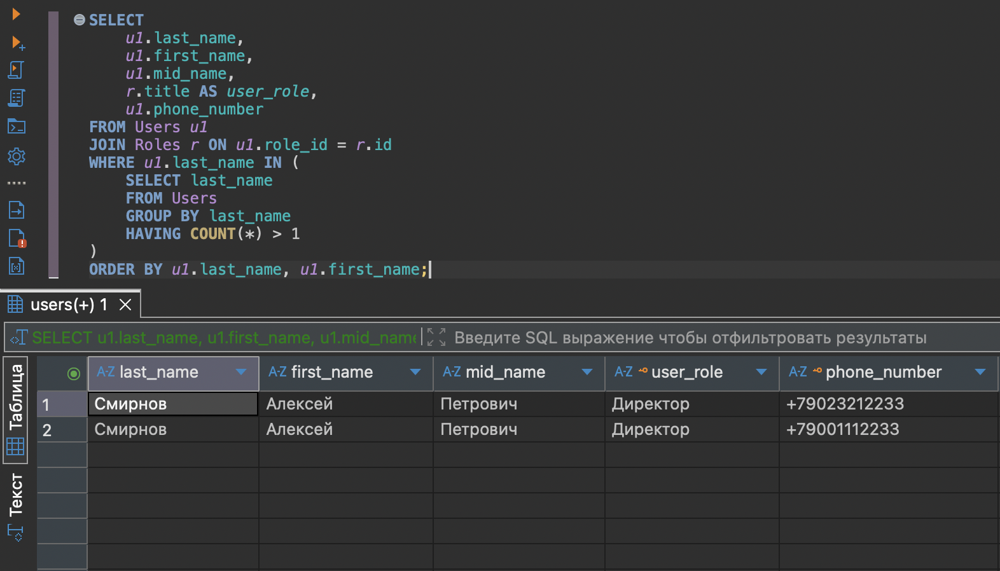

### 6. Подсчет количества товаров в разрезе категорий

```sql
SELECT category_id, COUNT(*) AS total_products FROM Products GROUP BY category_id;
```

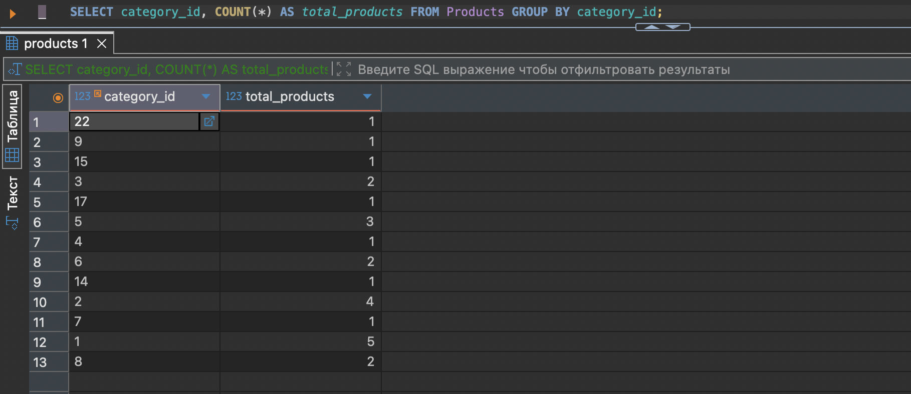

### 7. Фильтрация категорий по средней стоимости товаров

```sql
SELECT category_id, AVG(price) AS average_price FROM Products GROUP BY category_id HAVING AVG(price) > 1000;
```

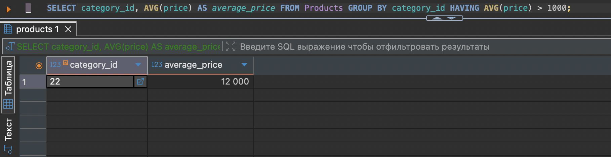

### 8. Финансовая аналитика по клиентам

```sql
SELECT client_id, SUM(amount) AS total_paid, MIN(amount) AS min_payment, MAX(amount) AS max_payment 
FROM Event_payments GROUP BY client_id;
```

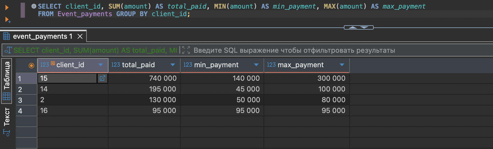

### 9. Поиск с использованием экранирования спецсимволов

```sql
SELECT title, description FROM Events WHERE description ILIKE '%\%%' ESCAPE '\';
```

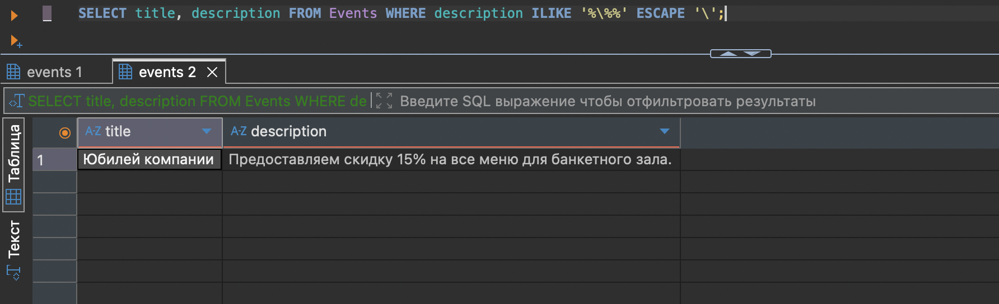

### 10. Связывание сущностей через внутреннее соединение

```sql
SELECT e.title AS event_name, m.last_name AS manager, c.last_name AS client 
FROM Events e
INNER JOIN Users m ON e.manager_id = m.id
INNER JOIN Users c ON e.client_id = c.id;
```

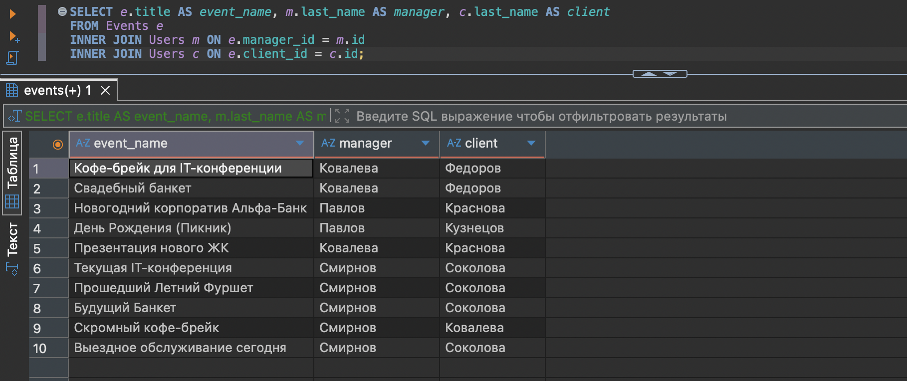

### 11. Левое соединение с обработкой значений NULL

```sql
SELECT p.title, COALESCE(c.title, 'Без категории') AS category_name 
FROM Products p
LEFT JOIN Product_categories c ON p.category_id = c.id;
```

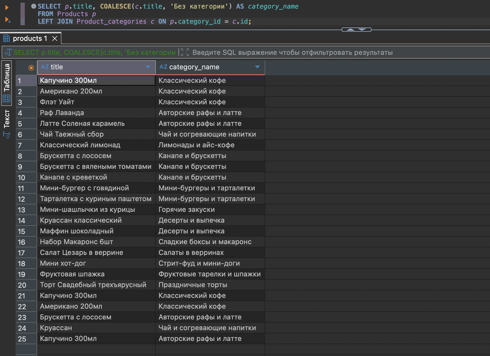

### 12. Правое соединение для поиска используемых справочников

```sql
SELECT DISTINCT pt.title FROM Event_payments ep 
RIGHT JOIN Payment_types pt ON ep.payment_type_id = pt.id 
WHERE ep.id IS NOT NULL;
```

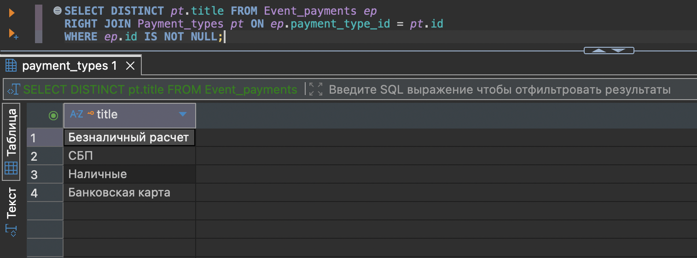

### 13. Полное внешнее соединение для поиска несоответствий

```sql
SELECT e.id AS event_id, ep.id AS payment_id FROM Events e 
FULL OUTER JOIN Event_payments ep ON e.id = ep.event_id 
WHERE e.id IS NULL OR ep.id IS NULL;
```

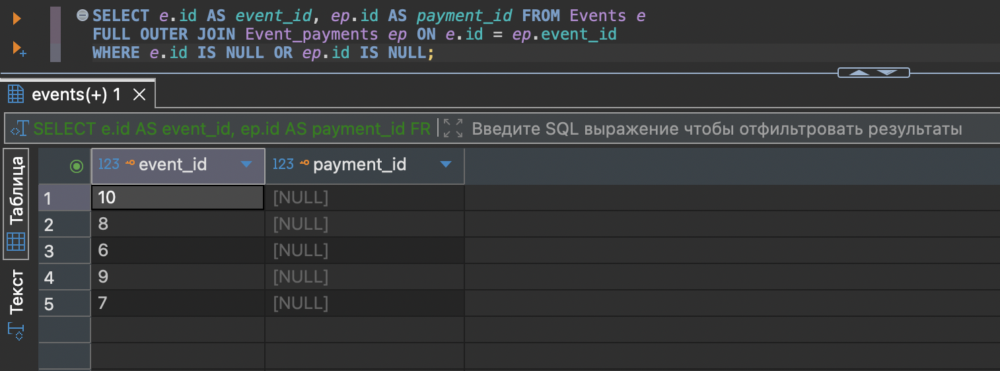

### 14. Проверка существования связанных записей (EXISTS)

```sql
SELECT id, login FROM Users u 
WHERE EXISTS (SELECT 1 FROM Event_payments ep WHERE ep.client_id = u.id);
```

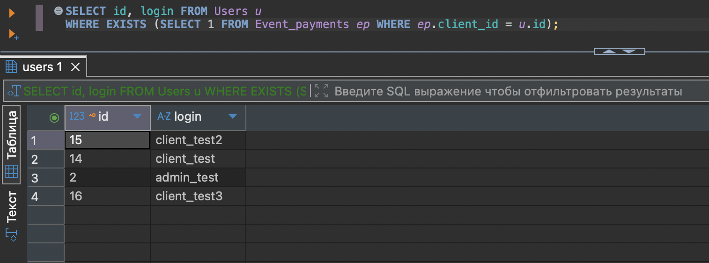

### 15. Фильтрация с использованием скалярного подзапроса

```sql
SELECT title, price FROM Products 
WHERE price > (SELECT AVG(price) FROM Products);
```

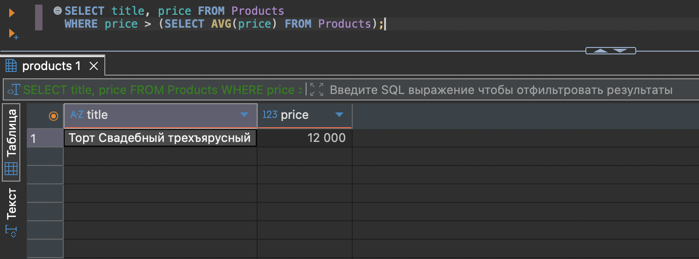

### 16. Объединение множеств с разметкой типа данных (UNION ALL)

```sql
SELECT first_name, last_name, phone_number, 'Клиент' AS user_type FROM Users WHERE role_id = (SELECT id FROM Roles WHERE title = 'Client')
UNION ALL
SELECT first_name, last_name, phone_number, 'Персонал' AS user_type FROM Users WHERE role_id != (SELECT id FROM Roles WHERE title = 'Client');
```

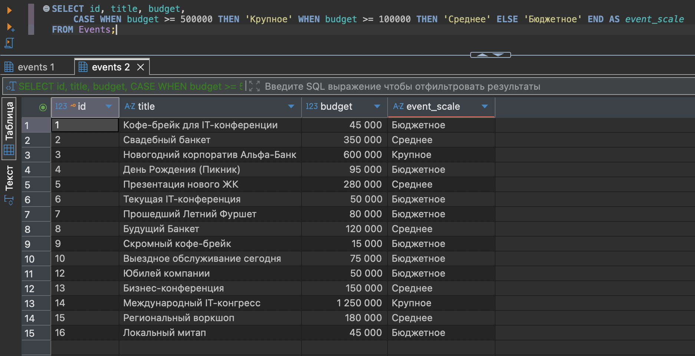

### 17. Классификация данных с помощью условной логики (CASE)

```sql
SELECT id, title, budget,
    CASE WHEN budget >= 500000 THEN 'Крупное' WHEN budget >= 100000 THEN 'Среднее' ELSE 'Бюджетное' END AS event_scale
FROM Events;
```

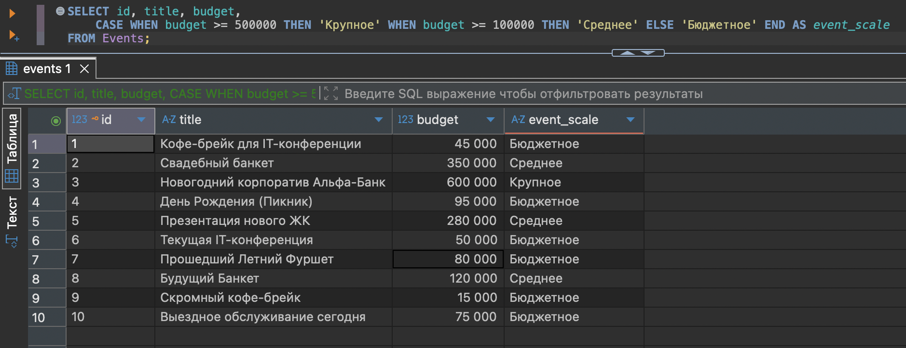

### 18. Поиск максимального значения в группах через CTE и оконные функции

```sql
WITH RankedProducts AS (
    SELECT category_id, title, price, ROW_NUMBER() OVER (PARTITION BY category_id ORDER BY price DESC) as rank
    FROM Products
)
SELECT category_id, title, price FROM RankedProducts WHERE rank = 1;
```

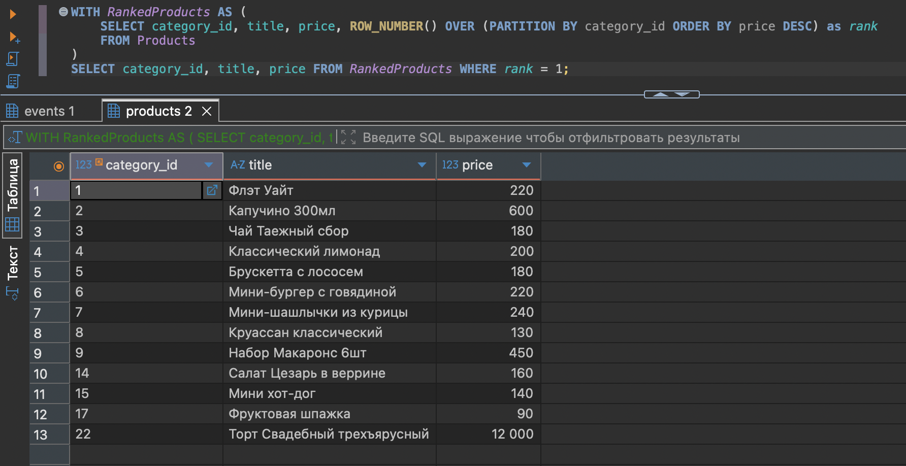

### 19. Ранжирование менеджеров по объему сборов

```sql
SELECT manager_id, SUM(budget) as total_budget, DENSE_RANK() OVER (ORDER BY SUM(budget) DESC) as manager_rank
FROM Events GROUP BY manager_id;
```

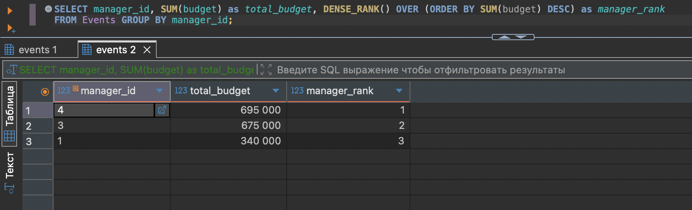

### 20. Пагинация данных (Постраничный вывод)

```sql
SELECT title, quantity FROM Ingredients ORDER BY title OFFSET 10 ROWS FETCH FIRST 5 ROWS ONLY;
```

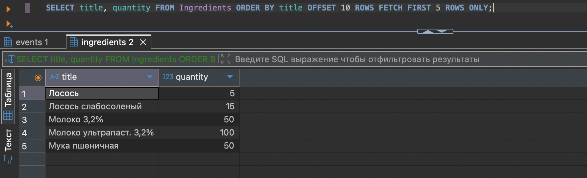

---

## 🛠️ Замечания по работе БД

В ходе анализа текущей структуры базы данных и представленных SQL-запросов было выявлено **10 критических замечаний и потенциальных точек оптимизации**:

### 📈 Нормализация и ограничения (Constraints)
1. **Нарушение 3НФ в таблице `Ingredient_Deliveries`:**  
   Поле `purchase_price` (цена закупки) дублируется при каждой поставке. Если цена ингредиента статична, её стоит вынести в таблицу `Ingredients`. Если же это историческая цена конкретной партии, то текущая структура допустима, но в таблице `Ingredients` отсутствует поле `current_price` для оперативной оценки себестоимости блюд.
2. **Избыточность и риски `Event_Reviews`:**  
   Связь `event_id INT UNIQUE REFERENCES Events(id)` жестко ограничивает систему: один отзыв на одно мероприятие. Однако в кейтеринге клиент может захотеть оставить раздельную оценку работе кухни (меню) и обслуживающему персоналу (официантам). 
3. **Отсутствие проверки дат в `Ingredient_Deliveries`:**  
   Поле `delivery_date` по умолчанию принимает `CURRENT_TIMESTAMP`, но отсутствует ограничение `CHECK (delivery_date <= CURRENT_TIMESTAMP)`, что позволяет случайно или намеренно внести поставку «из будущего».

### ⚡ Оптимизация типизации и производительности
4. **Неэффективное использование типов данных (`VARCHAR` vs `TEXT`):**  
   Для поля `company_name` указан `VARCHAR(150)`, а для `email` — `VARCHAR(255)`. В PostgreSQL использование `VARCHAR(N)` не дает преимуществ в скорости по сравнению с `TEXT`, но создает искусственные ограничения. Рекомендуется использовать `TEXT` с валидацией через регулярные выражения (для email) на уровне приложения или БД.
5. **Проблема типа `INT` для количества (`quantity`):**  
   В таблицах `Ingredients` (запрос 20) и `Ingredient_Deliveries` количество имеет целочисленный тип (`INT`). Для кейтеринга это критическая ошибка, так как специи, мясо или жидкости измеряются в граммах, килограммах и литрах (дробные значения). Необходимо использовать тип `NUMERIC(10, 3)`.
6. **Отсутствие индексов для внешних ключей (FK):**  
   PostgreSQL не создает индексы для `FOREIGN KEY` автоматически. В запросах №10, №11, №12 активно используются тяжелые `JOIN`. Без создания явных индексов на поля `manager_id`, `client_id` и `category_id` система будет выполнять полное сканирование таблиц (`Seq Scan`), что уронит производительность при росте базы.

### 🔍 Оптимизация и безопасность SQL-запросов
7. **Уязвимость к полнотекстовому поиску (Запрос №9):**  
   Запрос с оператором `ILIKE '%\%%'` и использованием маски `%` в начале строки полностью исключает возможность использования стандартных B-Tree индексов. Для оптимизации таких запросов необходимо подключать расширение `pg_trgm` и строить GIN/GIST индексы.
8. **Использование `SELECT *` (Запрос №3):**  
   Выборка всех полей `SELECT * FROM Products` в реальных клиент-серверных системах является плохой практикой (антипаттерном). Она увеличивает нагрузку на сеть и ломает логику приложения при добавлении новых колонок в таблицу.
9. **Хардкодинг идентификаторов (Запросы №4 и №16):**  
   В запросе №4 используется фильтрация по `status_id IN (3, 4)`, а в запросе №16 — подзапросы для поиска `title = 'Client'`. Использование «магических чисел» (id статусов) ведет к ошибкам, если в будущем справочники переименуются или сместятся. Зависимость от текстовых полей вроде 'Client' замедляет работу.
10. **Неконсистентность именования полей:**  
    В таблице `Users` используются поля `phone` (исходя из DDL `Suppliers`), а в запросе №16 внезапно вызывается `phone_number`. Отсутствие единого стандарта именования (snake_case vs camelCase или сокращений) усложняет поддержку кода.

---

## 📝 Заключение

В ходе выполнения лабораторной работы были успешно решены задачи по **модернизации и анализу реляционной базы данных** для автоматизации деятельности кейтеринговой компании:

* **Расширение архитектуры:** Разработана и внедрена подсистема учета материально-технического обеспечения (таблицы `Suppliers`, `Ingredient_Deliveries`, `Equipment`, `Event_Equipment`) и обратной связи (`Event_Reviews`), что позволило перевести БД со стадии изолированного хранения сущностей к полноценному описанию сквозных бизнес-процессов (от закупки сырья до анализа отзывов клиентов).
* **Практика сложной выборки:** Сформирован комплекс из 20 уникальных SQL-запросов. Были освоены как базовые механизмы фильтрации (`WHERE`, `BETWEEN`, `IN`), так и продвинутый аналитический инструментарий PostgreSQL: обобщенные табличные выражения (`CTE`), оконные функции (`ROW_NUMBER`, `DENSE_RANK`), условная логика (`CASE WHEN`) и операции над множествами (`UNION ALL`).
* **Аналитический аудит:** Проведен критический разбор спроектированной схемы данных, в результате которого локализованы слабые места в типизации (целочисленный учет весового товара) и заложен фундамент для оптимизации производительности (необходимость триграммных индексов для поиска по маске и индексирования внешних ключей).

Разработанная база данных полностью удовлетворяет требованиям целостности, масштабируемости и готова к интеграции с серверной частью клиент-серверного приложения.
