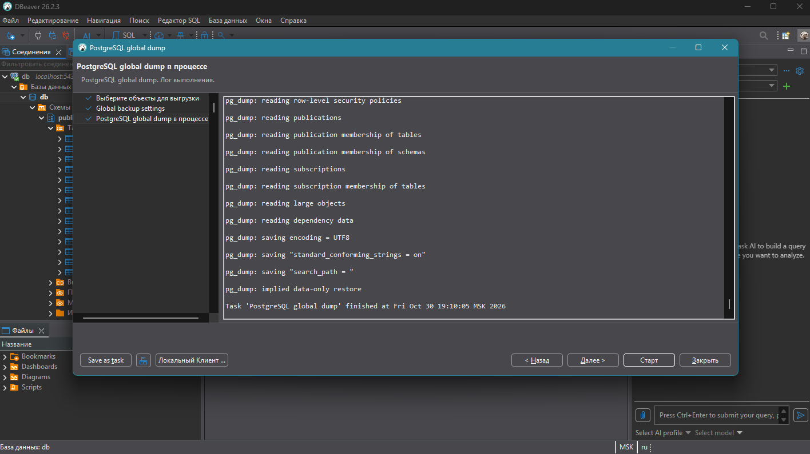

# 🏛️ Практика №7: Резервное копирование базы данных

**Дисциплина:** [Клиент-серверные системы управления базами данных](../README.md)  
**Бэкап-файл:** [backup_docker.sh](../backup_docker.sh)  
**Предыдущая работа:** [Практика №6: Работа с индексами](./sixth_report.md)
**Следующая работа:** [Практика №8: Сбор статистики базы данных](./eighth_report.md)

> 💡 *Примечание: Все имена, персонажи и данные в настоящей работе являются вымышленными. Любое совпадение с реальными людьми случайно.*

---

## 🎯 Техническое задание

1. Создать дамп схемы базы данных
2. Создать дамп базы данных двумя способами - через SSH и через GUI
3. Создать дамп определенной таблицы из базы данных
4. Сделать резервирование в каталог (размещение каждой таблицы в отдельный файл)
5. Создать скрипт для автоматического резервного копирования*
6. Создать новую базу данных и вставить туда один из созданных дампов для проверки работоспособности

---

## 📥 Создание дампов (Имена контейнера пользователя и пароль из вашего .env)

### 1. 

```bash
docker exec -i container pg_dump -U username -d my_database -s > db_schema_dump.sql
```

### 2. 

```bash
docker exec -i container pg_dump -U username -d my_database -F p > full_db_dump.sql
```

### 3. 

```bash
docker exec -i container pg_dump -U username -d my_database -t Events > events_table_dump.sql
```

### 4. 

```bash
docker exec -it container mkdir -p /var/lib/postgresql/data/backup_dir
docker exec -it container pg_dump -U username -d my_database -F d -f /var/lib/postgresql/data/backup_dir
```

## Через GUI (DBeaver)



## Скрипт автоматизации для Docker

```bash
CONTAINER_NAME="" # данные в .env
DB_USER="" # данные в .env
DB_NAME="" # данные в .env
DB_PASS="" # данные в .env
BACKUP_DIR="/var/backups/postgres_docker"
DATE=$(date +%Y-%m-%d_%H-%M-%S)
FILENAME="${BACKUP_DIR}/${DB_NAME}_docker_backup_${DATE}.sql"

mkdir -p "$BACKUP_DIR"

docker exec -i -e PGPASSWORD="$DB_PASS" "$CONTAINER_NAME" pg_dump -U "$DB_USER" -d "$DB_NAME" -F p > "$FILENAME"

if [ $? -eq 0 ]; then
    echo "[$(date)] Бэкап контейнера успешно создан: $FILENAME"
else
    echo "[$(date)] Ошибка при бэкапе контейнера!"
fi

find "$BACKUP_DIR" -type f -name "${DB_NAME}_docker_backup_*.sql" -mtime +7 -delete
```

## Проверка

```bash
docker exec -i имя_контейнера psql -U username -c "CREATE DATABASE my_database_test;"

docker exec -i имя_контейнера psql -U username -d my_database_test < full_db_dump.sql
```

---

## 📝 Заключение

В ходе выполнения практической работы были успешно освоены методы резервного копирования и восстановления данных в условиях контейнеризации приложений на базе платформы Docker.

Были достигнуты следующие результаты:
* **Интегрированы утилиты администрирования СУБД с Docker API**, что позволило выполнять изолированное извлечение схем данных и отдельных таблиц с помощью команды `docker exec` без необходимости установки СУБД на хост-систему.
* **Настроен пайплайн автоматического резервного копирования**, учитывающий специфику контейнеров (передача переменных окружения `PGPASSWORD` внутрь среды выполнения) и обеспечивающий безопасный экспорт дампов наружу, в постоянное хранилище хост-машины.
* **Проведена успешная верификация Disaster Recovery сценария**, в ходе которого дамп с хост-компьютера был штатно импортирован обратно в контейнеризованную СУБД в новую тестовую базу данных, подтвердив консистентность и переносимость конфигурации.

Использование Docker для развертывания БД совместно с настроенными скриптами бэкапа позволило создать современную, изолированную и легко масштабируемую инфраструктуру управления данными.
